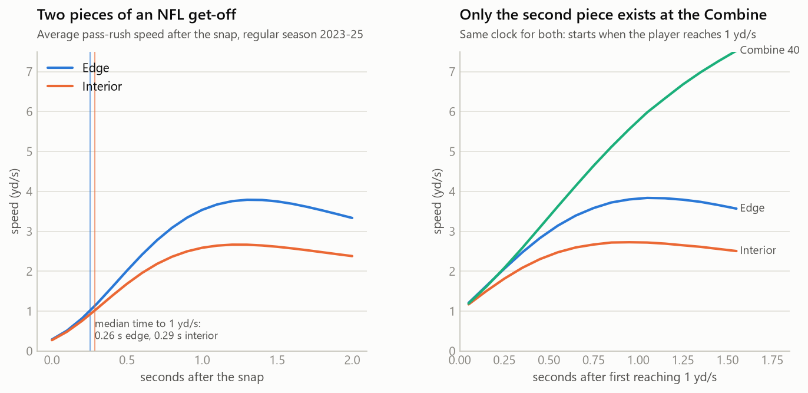
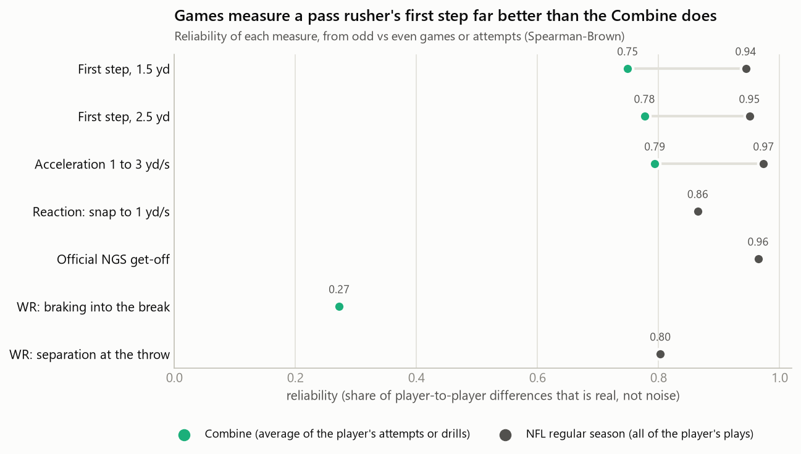
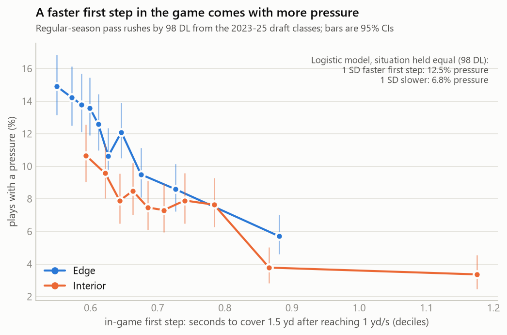
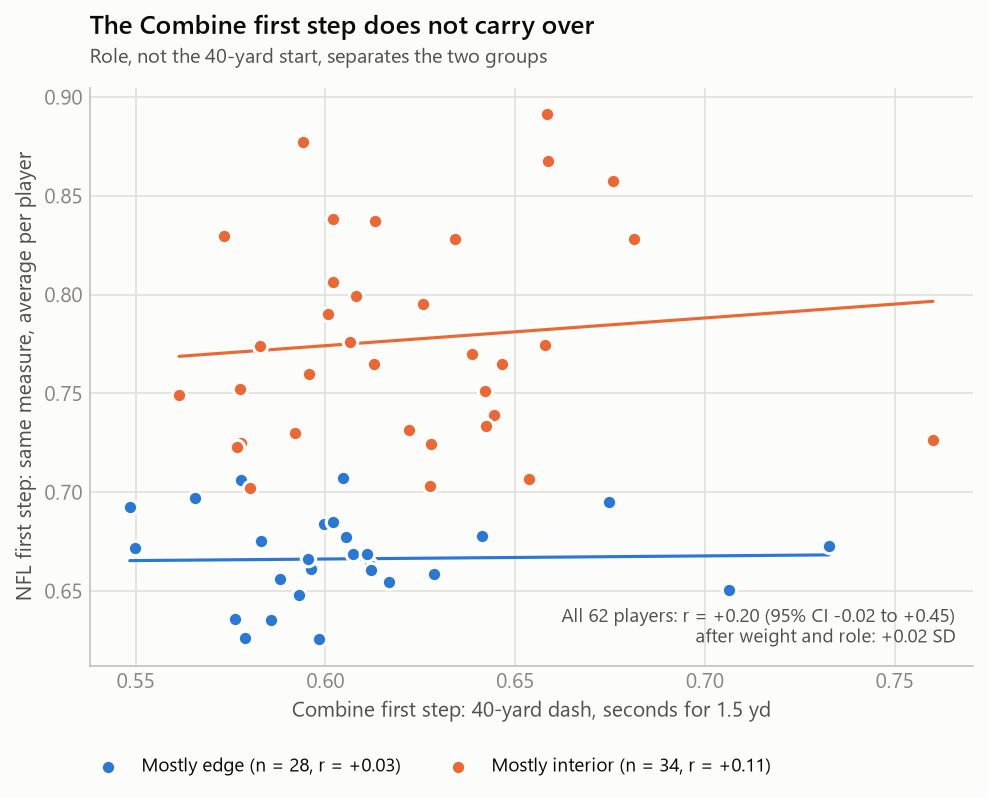
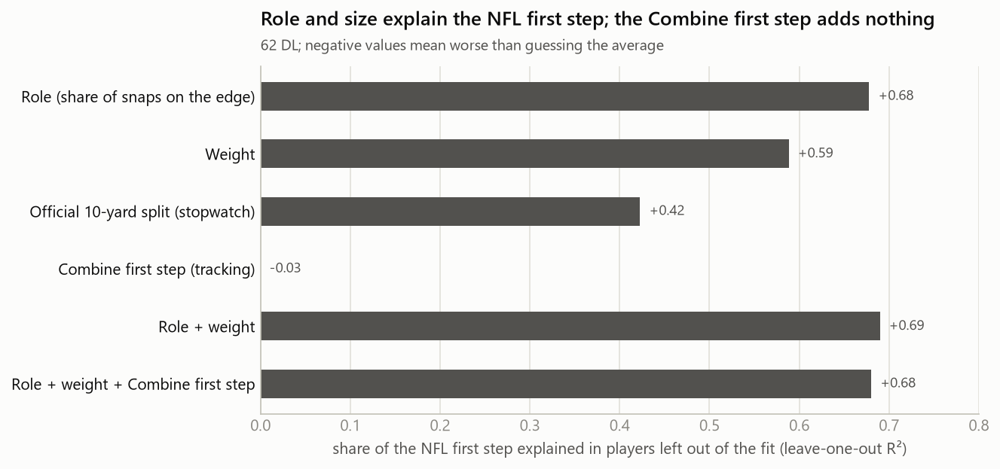
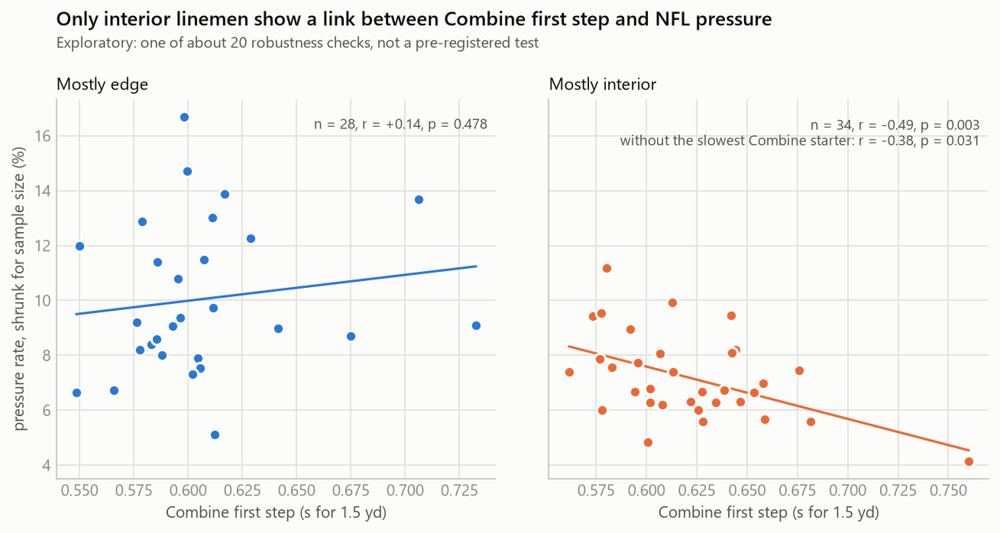

# Get-Off Is Two Skills. The Combine Clocks Only One.

*Linking 10 Hz Combine sensor data to regular-season pass rush for the 2023–25 draft classes*

## Why the first step

A pass rush is often won before the first block lands. NFL Next Gen Stats tracks a rusher's *get-off* every week, and teams pay for it in the draft. Combine sensors now record every prospect's 40-yard start at 10 Hz. So we can ask a direct question: **does the first step a defensive lineman shows at the Combine become the first step he shows on Sundays, and does it turn into pressure?**

We pre-registered four hypotheses before looking at any Combine-to-NFL relationship. Our answer is mostly *no*, and the reason is useful. An NFL get-off has two parts: reacting to the snap, and accelerating once moving. The Combine has no snap, so it can only time the second part. Even that part does not carry over to games once role and size are known. The in-game first step, by contrast, is one of the clearest pressure signals in the data.

## Measuring a first step the same way twice

**The start problem.** Combine recordings begin when the player is already moving, and the cut point varies from rep to rep. A 10-yard split computed from the first recorded frame agrees poorly with the official split (r = 0.47), even though the tracked 40 matches the official 40 well (r = 0.91, constant +0.32 s offset). Any first-step metric that starts its clock at the first frame inherits this noise.

**The fix: an anchored clock.** We start the clock when the player first reaches **1 yd/s**, at his position at that moment, both at the Combine and after the snap in games. From there:

- **First step (`burst_15`)**: seconds to cover 1.5 yards in a straight line. In games this usually ends before contact with a blocker (median 0.66 s).
- **Reaction (`t_react`)**: in games only, seconds from the snap to 1 yd/s.

Figure 1 shows why this split matters. After the snap, edge and interior rushers take about 0.26–0.29 s to reach 1 yd/s. On the anchored clock, the Combine 40 and NFL edge rushes track each other for about a quarter-second (interior rushes split off sooner); then game speed flattens against blockers while the Combine sprint keeps climbing.

**Data.** We use regular-season pass rushes from 2023–25 by players who tested as DL at the Combine. Each play is from a stance start, lined up on the edge or the interior, not nullified by penalty, and the player actually rushed. That gives 26,120 rushes by 98 players. The primary sample is the **62 players** with at least 50 such rushes and a clean Combine 40 start.

**Reliability first.** Before testing any link, we checked how well each measure separates players (Figure 2). In games, the first step and reaction are very stable from odd to even games (0.94 and 0.86). At the Combine, the same first step averaged over a player's attempts reaches 0.75: usable, but a snapshot. For contrast, we tried the receivers' equivalent, braking into a route break. It is not stable across Combine drills (0.27), so we did not pursue it.

## Pre-registered tests

The analysis plan, written before testing, fixed the measures, thresholds, covariates and a Holm correction across the three primary tests.

| | Question | Result | Verdict |
|---|---|---|---|
| H1 | Does the Combine first step carry into the NFL first step? | r = +0.20 (95% CI −0.02 to +0.45); +0.02 SD after weight and role | Not supported (Holm p = 0.23) |
| H2 | Is it tied to snap reaction, and does it beat the stopwatch? | Reaction r = +0.13 (CI −0.13 to +0.38); 10-yard split explains 42% of the NFL first step, tracking 0% | Descriptive |
| H3 | Does the in-game first step come with more pressure? | Odds ratio 0.74 per SD slower (CI 0.65 to 0.84) | **Supported** (Holm p < 0.001) |
| H4 | Does the Combine first step predict pressure beyond draft slot and the 10-yard split? | −0.27 percentage points per SD (CI includes 0) | Not supported (Holm p = 0.47) |

One deviation is reported openly. The plan defined a pass rush as any row with the `sack` field filled. That definition also includes 4.6% of snaps where the lineman dropped into coverage and could not create pressure. We removed those snaps and dropped `blitzing` as a covariate, because for linemen that column means "this player rushed". Results with the original definition lead to the same conclusions.

## Finding 1: In the NFL, both parts of the get-off matter

Holding the situation equal (down, distance, formation, score, alignment and reaction time), a first step one standard deviation faster comes with **12.5% pressure instead of 6.8%** across all 98 linemen (Figure 3). Reaction matters on top of that: every extra tenth of a second to react cuts the odds of pressure by about 10%. The pattern holds for edge and interior separately, without unblocked pressures, and with every alternative first-step measure in the plan.

## Finding 2: The Combine first step does not carry over

Across the 62 players, the Combine first step and the NFL first step are only weakly related (r = +0.20). That link disappears once we account for body weight and how often a player lines up on the edge (Figure 4). Within each role there is essentially no relationship (edge r = +0.03, interior r = +0.11).

What explains the NFL first step instead is **role and size** (Figure 5). Edge share alone explains 68% of the player-to-player differences in players left out of the fit, and weight explains 59%. The official 10-yard split explains 42%, mostly because it tracks weight (r = 0.86). The tracking-based Combine first step explains nothing, and adding it to role and weight does not help.

The Combine first step is also unrelated to snap reaction (r = +0.13). That fits Figure 1: reaction is learned against a real snap count, and no Combine drill provides one.

## Finding 3: Pressure follows the game, not the workout

Beyond draft slot and the 10-yard split, the Combine first step does not predict a player's pressure rate. Pressure rates are shrunk toward the league mean for small samples. The estimate points the expected way, but its interval is wide and includes zero. Out of sample, draft slot, the 10-yard split and role explain 44% of the differences in pressure rate between players; adding the Combine first step lowers that to 42% (leave-one-out).

One pattern deserves follow-up rather than a claim (Figure 6). Among mostly-interior linemen, a slower Combine start goes with less pressure (r = −0.49, n = 34). The link persists without the slowest starter (r = −0.38) and is absent on the edge. This was one of about 20 pre-specified robustness checks, so it is a hypothesis for the next draft class, not a finding.

## What teams can do with this

**Draft evaluation**
- Do not pay for Combine first-step burst on its own, especially for edge rushers. It does not forecast the NFL first step once role and size are known.
- Read the 10-yard split as mostly a size measure. Its link to the NFL first step comes through weight.
- For interior prospects, treat a slow tracked Combine start as a prompt to check film, not as a verdict.

**Week to week**
- Track the two parts of get-off separately from game tracking. Reaction (snap to 1 yd/s) and the first step (1.5 yards after that) are stable after about 50 rushes, and both are tied to pressure.
- Moving from one SD slower to one SD faster on the first step is worth almost six points of pressure rate (6.8% to 12.5%), so a weekly report can flag rushers who are getting slower.

**Development**
- Reaction is the part a workout never sees. Snap-count and get-off drills target the piece of get-off that the Combine cannot measure and that the game rewards.

**Measurement**
- Anyone using Combine tracking should anchor first-step timing on movement rather than on the first recorded frame. Otherwise the recording's start point adds noise as large as the differences between players.

## Limitations

- **Sample size.** With 62 players, only correlations above about 0.35 can be shown reliably. H1 rules out a strong link, not a small one.
- **Selection.** Players who never earned regular-season snaps are not in H1, H3 or H4.
- **Censoring.** The 2025 class has played one season.
- **Line of scrimmage.** It comes from integer yard lines (±0.5 yd), so we do not reproduce NGS get-off exactly. Our measures do not need it.
- **Causality.** None is claimed. Draft slot shapes both playing time and teammates.

## Appendix

- Pre-registered plan, with deviations: `ANALYSIS_PLAN.md`
- Code: `common.py` (anchored timing), `game_starts.py`, `combine_starts.py`, `tests.py` (H1–H4 and robustness), `figures.py`
- Receiver comparison: `../wr_breaks/` (break detection and reliability, no outcome tests)
- Public Kaggle notebook: to be added
