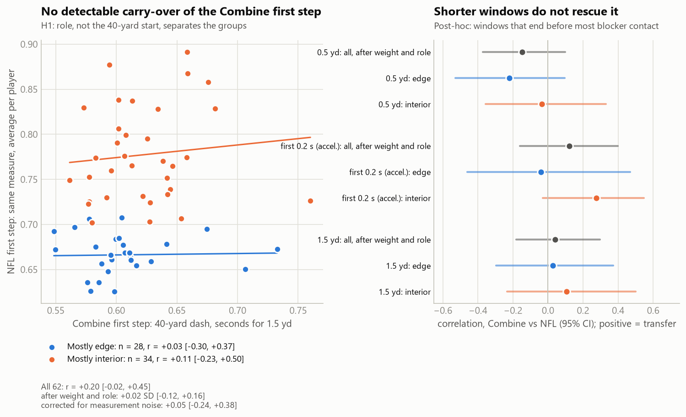
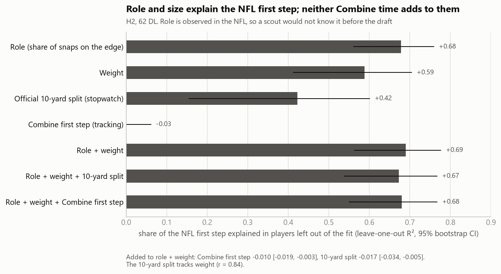
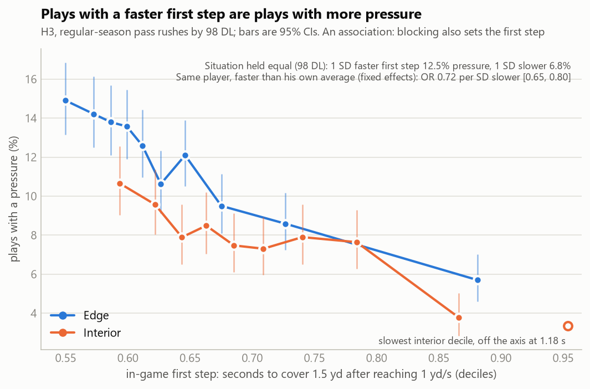

# Get-Off Is Two Skills. The Combine Clocks Only One.

*Linking 10 Hz Combine sensor data to regular-season pass rush for the 2023–25 draft classes*

## Why the first step

A pass rush is often won before the first block lands. Teams watch a rusher's *get-off* every week and pay for it in the draft. Combine sensors now record every prospect's 40-yard start at 10 Hz. So we ask: **does the first step a defensive lineman shows at the Combine become the first step he shows on Sundays, and does it turn into pressure?**

We pre-registered four hypotheses before looking at any Combine-to-NFL relationship. Our answer is mostly *no*, and the reason is useful. An NFL get-off has two parts: reacting to the snap, and accelerating once moving. The Combine has no snap, so it can only time the second part. Even that part shows no detectable carry-over once role and size are known. In games, by contrast, plays with a faster first step are clearly plays with more pressure.

## Measuring a first step the same way twice

**The start problem.** Combine recordings begin with the player already moving, and the cut point varies from rep to rep. A 10-yard split timed from the first recorded frame agrees poorly with the official split (r = 0.47), while the tracked 40 matches the official 40 (r = 0.91).

**The fix: an anchored clock.** We start the clock when the player first reaches **1 yd/s**, at his position at that moment, both at the Combine and after the snap in games.

- **First step (`burst_15`)**: seconds to cover 1.5 yards in a straight line.
- **Reaction (`t_react`)**: in games only, seconds from the snap to 1 yd/s.

Figure 1 shows median speed with the middle 50% of plays. Interior rushers' speed splits from the Combine curve about 0.15–0.2 s after 1 yd/s. The 1.5-yard window ends near 0.6 s for edge rushers and 0.7 s for interior rushers. For interior players, the in-game "first step" therefore partly measures the block, not only acceleration. Rushers also start moving about 0.2 s before the recorded snap frame. Position-derived speed shows the same rise, so this is not smoothing. If the snap frame is late by a constant amount, every reaction time shifts equally. If some rushers anticipate more, that difference is part of what reaction measures.

**Data.** We use regular-season pass rushes from 2023–25 by players who tested as DL at the Combine. Each play is from a stance start, lined up on the edge or the interior, not nullified by penalty, and the player rushed. That gives 26,120 rushes by 98 players. 79 of them have at least 50 such rushes, and **62** of those also have a clean Combine 40. Sixteen of the other 17 skipped the 40. They were picked earlier (median pick 66 vs 124) and played more on the edge, although neither difference is statistically clear. Their pressure rates match the 62.

**Reliability first** (Figure 2). Per trial, the Combine is the cleaner measurement. One 40 attempt has reliability 0.60, while one NFL snap has 0.01 once edge and interior are each compared with their own average. Games win only through volume: a season of snaps reaches 0.80, the mean of about two Combine attempts 0.75.

## Pre-registered tests

The plan fixed the measures, thresholds, covariates and a Holm correction across the three primary tests before any test was run.

| | Question | Result | Verdict |
|---|---|---|---|
| H1 | Does the Combine first step carry into the NFL first step? | r = +0.20 (95% CI −0.02 to +0.45); +0.02 SD after weight and role | Not supported (Holm p = 0.23) |
| H2 | Is it tied to reaction, and does it beat the stopwatch? | Reaction r = +0.13; 10-yard split explains 42% of the NFL first step, tracking 0% | Descriptive |
| H3 | Do plays with a faster first step have more pressure? | Odds ratio 0.74 per SD slower (CI 0.65 to 0.84) | **Supported** (Holm p < 0.001) |
| H4 | Does the Combine first step predict pressure beyond draft slot and the 10-yard split? | −0.27 points per SD (CI includes 0) | Not supported (Holm p = 0.47) |

Two deviations are reported openly. The plan's pass-rush definition also included 4.6% of snaps where the lineman dropped into coverage, and we removed them. We also dropped `blitzing` as a covariate, because for linemen it means "this player rushed". Both versions reach the same conclusions. Everything marked *post-hoc* below was added after a review round.

## H1: No detectable carry-over

Across 62 players the Combine and NFL first steps are weakly related (r = +0.20). After weight and role the link is +0.02 SD (CI −0.12 to +0.16), and within each role it is near zero (Figure 3). Measurement noise does not explain this: reliability caps the observable correlation at 0.77, and the noise-corrected estimate is +0.05 (CI −0.24 to +0.38). The data rule out a strong link, not a small one.

*Post-hoc*, we shortened the window to end before most contact: the first 0.5 yards, or acceleration over the first 0.2 s. No window shows transfer. The closest is interior early acceleration (r = +0.28, CI −0.03 to +0.55).

## H2: Role and size explain the NFL first step

Out of sample, edge share explains 68% of the NFL first step and weight 59% (Figure 4). The official 10-yard split explains 42%, because it tracks weight (r = 0.84). Added to role and weight, it lowers out-of-sample accuracy (−0.017, CI −0.034 to −0.005), as does the tracked Combine first step (−0.010). Role is observed in the NFL, so a scout cannot know it at the Combine. The Combine first step is also unrelated to snap reaction (r = +0.13).

## H3: Plays with a faster first step are plays with more pressure

Holding the situation equal (down, distance, formation, score, alignment and reaction time), a first step one SD faster comes with **12.5% pressure instead of 6.8%** across all 98 linemen (Figure 5). *Post-hoc*, the link holds within the same player: with player fixed effects, the odds ratio is 0.72 per SD slower (CI 0.65 to 0.80). It is therefore not just faster edge rushers pressuring more. It also holds in the pre-contact 0.5-yard window (OR 0.86, CI 0.80 to 0.91). Reaction matters on top: each extra tenth of a second cuts the odds of pressure by about 10%.

This is an association, not a pure trait effect. A rusher who is unblocked or wins early accelerates freely, and one who meets a double team slows at once. We cannot observe blocking schemes, because blockers are not tracked.

## H4: Pressure follows the game, with one interior exception

Beyond draft slot and the 10-yard split, the Combine first step does not predict pressure rate. Rates are shrunk toward each role's own mean (10.5% edge, 6.5% interior). Out of sample, it lowers accuracy from 44% to 42%.

One exploratory pattern survives every check we could run (Figure 6). Among mostly-interior linemen, a slower Combine start goes with less pressure (r = −0.49, n = 34):

- after weight and a nose-tackle flag: r = −0.48 (CI −0.70 to −0.10);
- dropping any single player: r stays between −0.53 and −0.40;
- Spearman: −0.46.

It is one of about 20 checks, though. Its p = 0.003 sits just above a Bonferroni threshold of 0.0025. The same Combine measure also does not predict interior players' NFL first step. It may capture explosiveness into contact rather than open-field burst, or it may be chance. The 2026 draft class can confirm it.

## What teams can do with this

**Draft evaluation**
- Do not pay for Combine first-step burst on its own, especially for edge rushers.
- Read the 10-yard split as mostly a size measure.
- For interior prospects, a slow tracked start is a reason to check film, pending confirmation.

**Week to week**
- Track reaction (snap to 1 yd/s) and the first step separately from game tracking.
- Single snaps are noise, so use about 50+ rushes per player.

**Development**
- Reaction is the part a workout never sees and the game rewards. Snap-count drills target it.

**Measurement**
- Anchor first-step timing on movement, not on a recording's first frame.

## Limitations

- **Sample size.** With 62 players, only correlations above about 0.35 can be shown reliably.
- **Selection.** Players without regular-season snaps are not in H1, H3 or H4, and the players who skipped the 40 lean toward early picks.
- **Censoring.** The 2025 class has played one season.
- **Line of scrimmage.** It is known only to ±0.5 yd, and the snap frame timing is approximate.
- **Causality.** None is claimed.

## Appendix

- Plan and deviations: `ANALYSIS_PLAN.md`
- Code:
  - measurement: `common.py`, `game_starts.py`, `combine_starts.py`
  - pre-registered tests: `tests.py`
  - post-hoc review checks: `review_round2.py`, `cv_h4.py`
  - figures: `figures.py`
- Receiver comparison: `../wr_breaks/`
- Public Kaggle notebook: to be added
